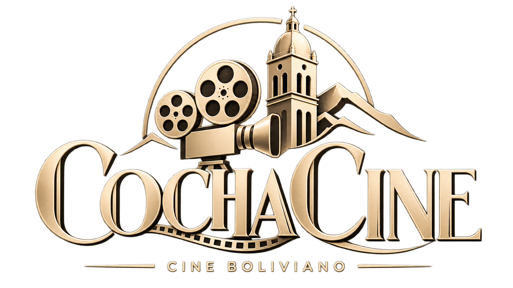
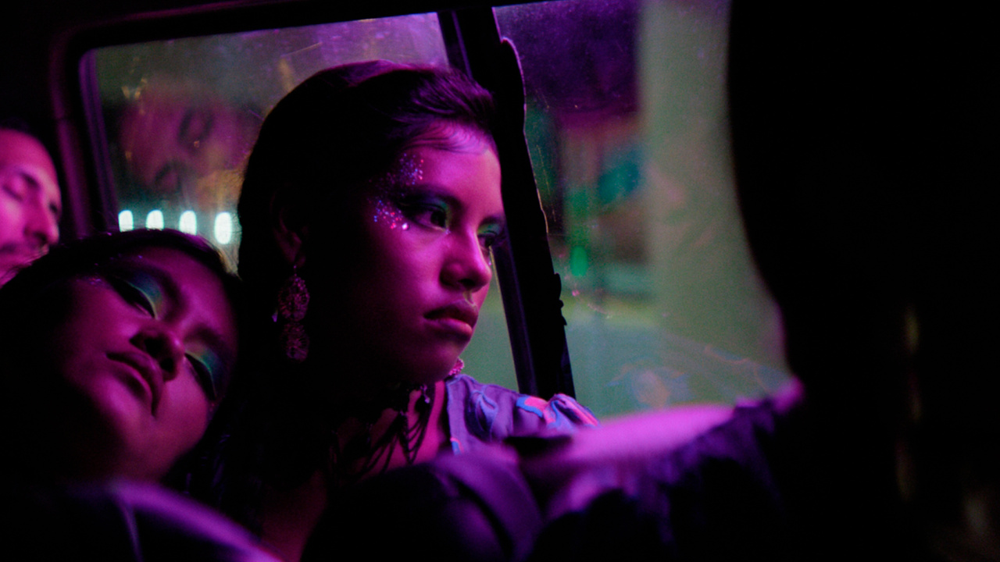
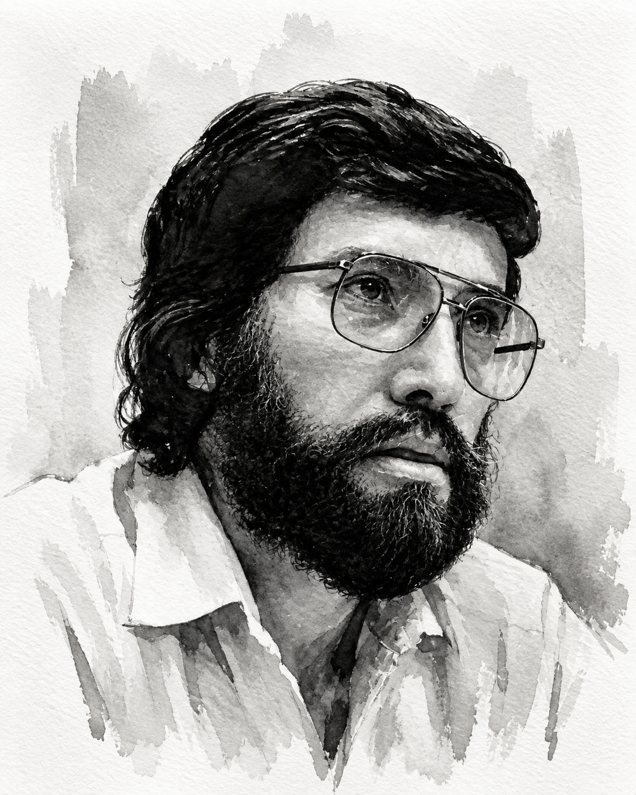
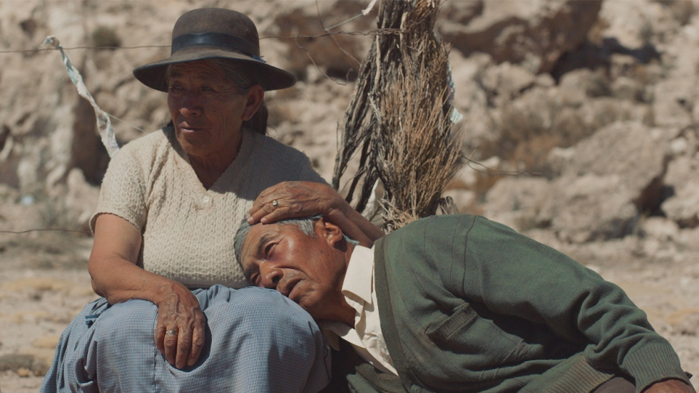
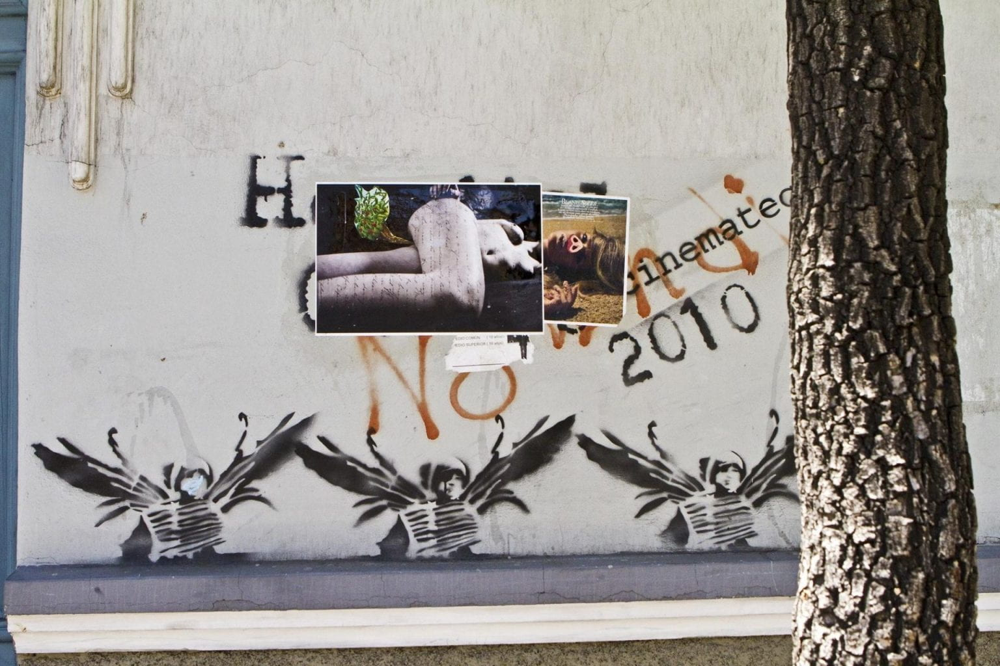

<div align="center">
  
  <h1>Cochacine</h1>
  <p><em>An editorial archive of Bolivian cinema — a house, not a moodboard.</em></p>
  <p>
    <a href="https://github.com/FabriCrespo/CochaCine/actions/workflows/ci.yml">
      
    </a>
    <a href="https://cochacine.vercel.app">
      
    </a>
    <a href="LICENSE">
      
    </a>
  </p>
  <p>
    
    
    
    
    
  </p>
  <p>
    <a href="https://github.com/FabriCrespo/CochaCine">Repo</a>
    ·
    <a href="https://github.com/FabriCrespo">Fabricio Crespo</a>
    ·
    <a href="https://fabricrespo.github.io/Portfolio/">Portfolio</a>
  </p>
</div>

<br />

<p align="center">
  
  
</p>
<p align="center">
  
  
</p>
<p align="center">
  <sub>Home program · Director spotlight · Essential reading · The library</sub>
</p>

---

## What it is

Cochacine is a small cinema house on the web: a curated catalog of films **produced in Bolivia**, a vitrine for what is playing now, and director rooms for the people who made the climate.

It is not a streaming app. Not Cine Center. Not TMDB Popular with a flag filter.

| Route | Room |
| :--- | :--- |
| `/` | Program — hero, most beloved, decades, reading, masters, contemporary cinema |
| `/archivo` | The stacks — search, genre, year, sort |
| `/pelicula/:id` | Ficha — poster, English plot, credits, trailer, where to watch |
| `/director/:id` | Ruiz, Sanjinés, Loayza — essays, awards, filmography linked into the catalog |
| `/project` | **Case study** — problem, real stack, decisions, shipped vs placeholder |
| `/admin` | Editor — correct copy and posters when the databases lie |

The longer argument lives in the app: open **`/project`**.

---

## The problem

On TMDB, `origin_country` is often copied from the original language. A Bolivian film in Spanish becomes Spanish. *Cuestión de fe* vanishes from “Bolivia.” `discover?with_origin_country=BO` is a hole.

Festival pages and Letterboxd lists exist. A house that treats the catalog as an editorial object — English for an international reader, the right country, the right plot, a poster that is a poster — did not.

---

## Stack (the real one)

The brief said “Next, CMS, auth, DB.” This is what shipped, on purpose.

| Layer | Choice | Why not the template |
| :--- | :--- | :--- |
| UI | React 19 · Vite 8 · TypeScript · Tailwind 4 · React Router 8 | Not Next.js. No SSR budget. The catalog is a client read of TMDB. |
| Data | TanStack Query (persisted) · Axios · domain mappers | UI never sees `vote_average`. Components talk to hooks, not Axios. |
| Catalog | TMDB + [Wikidata harvest](scripts/harvest-bolivia-ids.mjs) (`P495` = Bolivia) | `origin_country=BO` misses the canon. |
| Copy | `directors.json` + typed config | Not a CMS. Three filmmakers is not a Strapi install. |
| Overrides | Supabase — posters, English copy, trailers, extra titles | Postgres is the red pen, not the library. |
| Auth | Supabase Auth (email + session) + `editors` RLS | Not a password in `.env`. Writes need a JWT. |
| Motion | CSS | No Framer. `prefers-reduced-motion` turns the show off. |
| Deploy | Vercel SPA rewrite | |

```
UI  →  hook  →  Axios (api/)  →  DTO mapper  →  Movie  →  overlay Supabase  →  UI
```

Map: [`src/ARQUITECTURA.ts`](src/ARQUITECTURA.ts)

---

## Decisions

**Serif** — Cormorant for names, Newsreader for essays, Source Sans for wayfinding. A house prints a program; it does not ship a dashboard.

**Dark, then paper** — Ivory on ink in the cinema. Paper (`#F6F5F0`) for long reading. Gold (`#CBB89A`) is a rule, not a fill.

**Not Shopify** — Not a store. Ticket links for *La Hija Cóndor* are curated by hand.

---

## Built vs not

**Shipped**

- Wikidata harvest into TMDB IDs, plus language allowlist (`es`, `ay`, `qu`, `gn`) and a veto for foreign shoots that only used the landscape
- Archive filters; home rails by decade
- English-first images and plots (TMDB → IMDb fallback → editorial override)
- Editor: Supabase Auth + RLS, then posters, copy, and titles TMDB never listed
- Director filmographies linked to a real ficha when the title exists
- Home descent: Averno, Utama, *La Hija Cóndor*

**Not this**

- No public accounts or a recommendation engine
- Only three director rooms — not a director CMS
- `LoayzaSpecial.tsx` is leftover and unwired

---

## The hard parts

1. **The country field is a lie.** Discover-with-Bolivia misses the canon. The catalog is a filter (Wikidata + production countries + language + veto), not a dump.
2. **The house speaks English; the records do not.** Spanish overviews and posters are the default. The pipeline prefers English art, scrapes IMDb when the plot is still Spanish, and lets the editor overwrite both.
3. **Names have to meet records.** Editorial lists say *Yawar Mallku*; TMDB may say *Blood of the Condor*. Matching folds accents, scores titles, and refuses weak year mismatches.

---

## CI

Every push and pull request runs [GitHub Actions](https://github.com/FabriCrespo/CochaCine/actions/workflows/ci.yml): `npm run lint`, `npm test`, and `npm run build`. The badge at the top of this README tracks that workflow.

## Run locally

```bash
cp .env.example .env
npm install
npm test
npm run dev
```

| Variable | Need |
| :--- | :--- |
| `VITE_TMDB_TOKEN` | Required — TMDB read token |
| `VITE_SUPABASE_URL` | Optional for browsing; required for `/admin` |
| `VITE_SUPABASE_PUBLISHABLE_KEY` | Same |

### Editor (Supabase Auth)

1. Run `supabase/migrations/20260902_editor_auth.sql` and `20260903_claim_editor.sql` in the SQL editor.
2. Authentication → Users → add the editor (email + password). Confirm the email if the project requires it.
3. Sign in at `/admin`. The first account to sign in becomes the editor. There is no public sign-up.

Then open `/` for the house and `/project` for the case study.

```bash
npm run build    # tsc -b && vite build
npm run preview
```

---

<div align="center">
  <p><strong>Project by <a href="https://github.com/FabriCrespo">Fabricio Crespo</a></strong></p>
  <p>
    <a href="https://github.com/FabriCrespo/CochaCine">CochaCine</a>
    ·
    <a href="https://fabricrespo.github.io/Portfolio/">Portfolio</a>
  </p>
</div>
